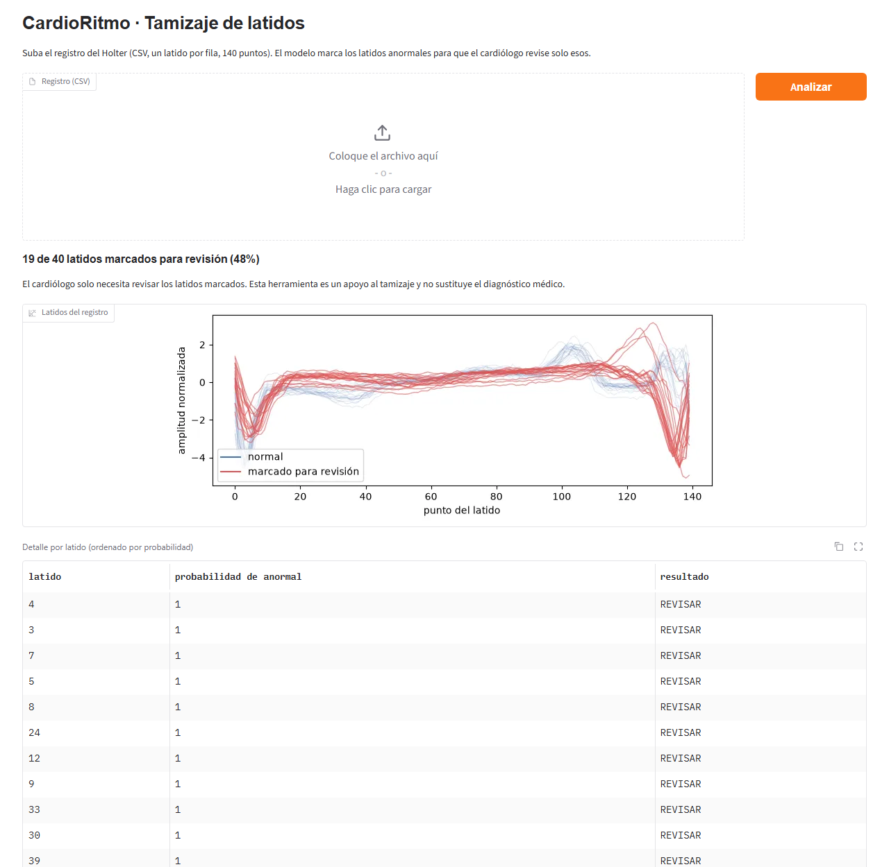

# AA3 · Examen del Parcial II · Equipo 7

## Integrantes
- Santiago Romo Rubio (SantRR)
- Edgar Ivan Galvez Ortega (0mudkip)

## Quién hizo qué
| Integrante | Problema | Qué hizo |
|---|---|---|
| Santiago Romo Rubio | CardioRitmo (`ecg/`) | Cuaderno DEV (exploración, preparación, línea base, MLP, Conv1D y GRU, evaluación en la prueba, análisis de errores y límites del modelo), `resultados_ecg.csv`, modelo guardado, folleto y PMV en Gradio (`pmv/app_ecg.py`) |
| Edgar Ivan Galvez Ortega | Compra Fácil Bajío (`resenas/`) | Cuaderno DEV (exploración, preparación, línea base, TF-IDF + red densa, Embedding + Bi-LSTM y BETO ajustado), `resultados_resenas.csv` y modelo guardado |

## Modelo elegido
- **CardioRitmo (latidos):** red convolucional Conv1D de 6,369 parámetros (`ecg/modelo/modelo_ecg.keras`). En la prueba marca 99 de cada 100 latidos anormales (413 de 416; meta 95) y solo marca por error 0.5 de cada 100 normales (3 de 584; meta ≤ 5). Validado únicamente con latidos de un paciente: ver limitaciones en `ecg/folleto_ecg.pdf`.
- **Compra Fácil Bajío (reseñas):** TF-IDF con bigramas + red densa (`resenas/modelo/modelo_resenas.keras` + `vectorizador_tfidf.joblib`). En la prueba marca 92 de cada 100 reseñas negativas (meta 90) y 91 de cada 100 marcadas son negativas (meta 85).

## PMV (punto extra)

### CardioRitmo: `pmv/app_ecg.py`
App web local en Gradio que carga el modelo guardado en `ecg/modelo/modelo_ecg.keras` y clasifica los latidos de un registro.

**Requisitos:** Python 3.11 con `keras>=3`, `torch`, `gradio`, `pandas`, `numpy` y `matplotlib`:
```bash
pip install "keras>=3" torch gradio pandas matplotlib
```

**Cómo correrla** (desde la raíz del repositorio):
```bash
python pmv/app_ecg.py
```
Abrir http://127.0.0.1:7860. Al abrir, la app analiza el registro de ejemplo `pmv/ecg_ejemplo.csv` (40 latidos). Para analizar otro registro se sube un CSV sin encabezado, con un latido por fila y 140 valores por latido, y se presiona **Analizar**. La app valida el archivo, normaliza cada latido, marca como "REVISAR" los latidos con probabilidad de anormal ≥ 0.5 y muestra el resumen, la gráfica y el detalle por latido.


